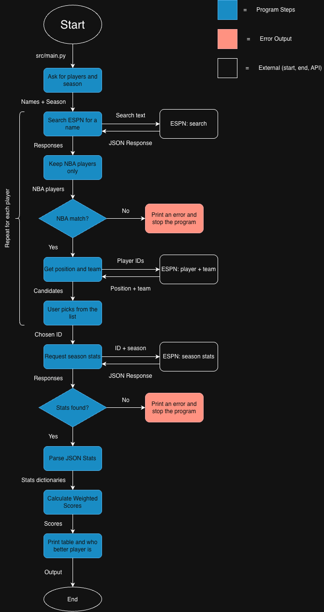

# NBA Player Comparison Tool

A Python command-line tool that compares two NBA players' stats side by side and scores each one for a chosen season.

## The Problem

I have followed the NBA my whole life, and debates about who is the greatest of all time or whether one is better than another almost always come down to statistics. Finding credible numbers for a specific player and season means looking through multiple sources, which is slow and makes it hard to back up an argument. Without an easy way to compare players fairly, these debates stay shallow and rarely get the nuance they deserve.

## How It Works

I am building a Python command line program that lets you enter two NBA players and a season and prints their key stats side by side. It also calculates an overall score for each player from a weighted formula, so debates can be settled with clear, consistent numbers.

The MVP includes:

- Searching ESPN by player name, then letting the user pick from a list that shows each player's position and team for the chosen season
- Requesting season stats from ESPN's public NBA endpoints, which needs no API key
- Printing points, rebounds, assists, and shooting percentages side by side
- Calculating a weighted overall score and showing which player scores higher

The planning documents are in the `docs/` folder: the [Eisenhower matrix](docs/Eisenhower%20Matrix.pdf) and the system diagram source file, [diagram.drawio.xml](docs/diagram.drawio.xml).

## Tech Stack

- **Language:** Python
- **requests:** Sends the HTTP calls to ESPN and returns the JSON response
- **json:** Reads the data ESPN sends back into Python dictionaries
- **Data source:** ESPN's public NBA endpoints, which needs no API key
- **curl:** Used in the terminal to test the endpoints before writing any code
- **Git and GitHub:** Version control for the project, with a commit history that follows my build plan

## Roadmap

- [ ] Career-wide overall score across all seasons
- [ ] Percentile rankings against the rest of the league
- [ ] Playoff stats and advanced metrics such as PER
- [ ] Saving ESPN responses to a local file so repeat lookups make fewer requests
